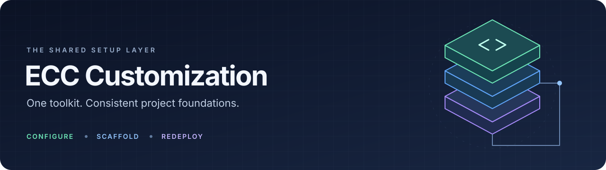
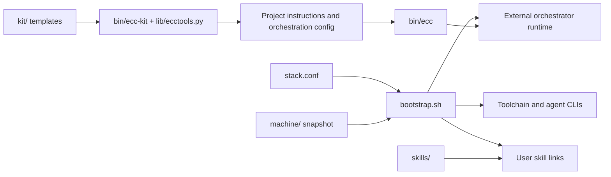

# ECC Customization

[](LICENSE)
[](lib/ecctools.py)
[](bootstrap.sh)

A shared customization layer for an ECC and OpenClaw development setup: bootstrap a Mac, scaffold project practices, distribute agent skills, and capture selected user settings for redeployment.

The orchestration engine lives in [openclaw-ecc-orchestrator](https://github.com/kennylhilljr/openclaw-ecc-orchestrator); platform specifications, inventory and OpenClaw backups are supplied by [agent-control-plane-infra](https://github.com/kennylhilljr/agent-control-plane-infra). This repository supplies their local setup and project templates. It does not include those runtimes or a standalone application server.

[Quick start](#quick-start) · [Configuration](#configuration) · [Commands](#commands-and-examples) · [Testing](#testing) · [Security](#security-boundaries) · [Redeployment guide](docs/REDEPLOY.md)

## Architecture and layout



| Path | Responsibility |
| --- | --- |
| [bootstrap.sh](bootstrap.sh) | Ordered macOS installation, restoration and verification steps |
| [stack.conf](stack.conf) | Tool versions, repository names, paths and Keychain item names |
| [bin/ecc](bin/ecc) | Finds a project's configuration and delegates to the external orchestrator |
| [bin/ecc-kit](bin/ecc-kit) | Creates, compares and syncs project templates |
| [bin/ecc-snapshot](bin/ecc-snapshot) | Captures selected user settings; optionally invokes the external OpenClaw backup tool |
| [bin/openclaw-gh-app-token](bin/openclaw-gh-app-token) | Prints a GitHub installation token for the `openclaw-ops-assist` App (bash) |
| [machine/ops/](machine/ops/workspace-ops.settings.json) | Tracked Claude Code settings for the OpenClaw ops agent, merged by the `ops` step |
| [tests/](tests/) | `unittest` tests for the `ops` step, the settings merge and the token command |
| [lib/ecctools.py](lib/ecctools.py) | Python helpers for templates, snapshots, restores, plugin registration and secret scanning |
| [kit/](kit/) | Agent instructions, build/review skills, lessons ledger and orchestration templates |
| [skills/](skills/README.md) | Shared ECC operation, EARS notation and product requirements skills; SDD reference documents |
| [machine/](machine/README.md) | Snapshot destination (no captured manifest yet), plus the hand-maintained `machine/ops/` settings |
| [.githooks/pre-commit](.githooks/pre-commit) | Scans staged file contents for secret-shaped strings |
| [docs/REDEPLOY.md](docs/REDEPLOY.md) | Migration procedure, owner tasks and recovery notes |
| [AGENTS.md](AGENTS.md), [CLAUDE.md](CLAUDE.md) | Instructions for coding agents working on this repository |

`kit/AGENTS.md` is a template for generated projects. Its branch policy and example gates describe those projects; they do not establish tests or CI for this repository. The root `AGENTS.md` is the agent guidance for this repository. The file named `kit/.orchestration/config.yaml` currently contains JSON syntax.

## Dependencies and installation

The full bootstrap targets **macOS**, with Xcode command line tools and an interactive owner available for sign-ins, trust prompts and Keychain entry. Git is needed to clone this repository. Bootstrap installs Homebrew if needed, then the formulas and Node toolchain listed below. Network access and access to the configured repositories and package registries are required.

The Python helper uses **Python 3.9 or newer and the standard library only**. There is no Python dependency installation or package manifest here. Its local help and scan commands can run without installing the macOS stack; that does not establish full cross-platform support.

### Safe evaluation outside macOS

On Linux or in Codex Cloud, limit evaluation to the non-mutating syntax, help and scan commands below:

```sh
bash -n bootstrap.sh stack.conf
sh -n bin/ecc bin/ecc-kit bin/ecc-snapshot .githooks/pre-commit
python3 lib/ecctools.py --help
python3 lib/ecctools.py kit-new --help
bin/ecc-kit new --help
./bootstrap.sh --help
python3 lib/ecctools.py scan README.md stack.conf docs
```

Do not run the bootstrap there. `ECC_BOOTSTRAP_ANY_OS=1` bypasses only its operating-system guard; it does **not** make Homebrew, Keychain, launchd or any other macOS bootstrap step portable.

Current values in `stack.conf`:

| Component | Configuration |
| --- | --- |
| Homebrew formulas | `git gh uv jq python@3.13` |
| Node / nvm | Node `24`, nvm `v0.40.3` |
| Agent CLIs | `@anthropic-ai/claude-code@latest`, `@openai/codex@latest`, `@google/gemini-cli@latest` |
| OpenClaw | `openclaw@2026.9.6` |
| ECC plugin | Marketplace `affaan-m/ECC`, plugin `ecc@ecc`; Claude user scope and Codex installation |
| Certification runners | `claude,codex,gemini` |

The stack is **partly pinned**: the three agent CLIs track `latest`, and the plugin and repository updates are not locked to commit SHAs. Gemini uses repository skills rather than an ECC plugin installation in the bootstrap.

## Quick start

Clone and inspect the configuration before running installation:

```sh
git clone https://github.com/kennylhilljr/ecc-customization.git
cd ecc-customization
./bootstrap.sh --help
python3 lib/ecctools.py --help
```

On the target Mac, review `stack.conf` and preview the steps:

```sh
./bootstrap.sh --dry-run
./bootstrap.sh
```

Bootstrap runs `prereqs`, `brew`, `node`, `clis`, `repos`, `runtime`, `ecc`, `skills`, `shell`, `machine`, `openclaw`, `ops`, `secrets`, `launchd`, then `verify`. These install the toolchain and CLIs, clone configured repositories, create a detached runtime worktree outside Documents, link skills, add `bin/` to the zsh PATH, restore any snapshot, configure OpenClaw, set up the OpenClaw ops agent, offer Keychain entry, install background agents and check configured projects.

Finish the summary's owner tasks and rerun the relevant steps. Sign-ins include `gh auth login`, `claude auth login`, `codex login`, and Gemini's interactive sign-in when using an account. OpenClaw may need onboarding or `openclaw doctor` after restoration. Use an API key provider as directed by the redeployment guide.

A dry run previews actions but still reads configuration and probes local tools. Installation can update packages, runtime worktrees, symlinks and launchd agents on subsequent runs; it is not an immutable or transactional deployment. Warnings in the summary matter even when the script exits successfully.

## Configuration

`bootstrap.sh`, `bin/ecc` and `bin/ecc-snapshot` source [stack.conf](stack.conf) as shell code. Keep it trusted, use Bash 3.2 compatible `KEY="value"` assignments, and store no credential values in it.

| Setting | Default / use |
| --- | --- |
| `GITHUB_DIR`, `GITHUB_OWNER` | `~/Documents/GitHub`, `kennylhilljr`; clone location and owner |
| `ORCH_REPO`, `INFRA_REPO` | `openclaw-ecc-orchestrator`, `agent-control-plane-infra` |
| `PROJECT_REPOS` | Space-separated `research-mcp ctxd` |
| `ECC_RUNTIME_DIR` | `~/.local/share/openclaw-ecc-orchestrator/runtime`; detached runtime worktree |
| `ECC_STATE_DIR` | `~/.local/state/openclaw-ecc-orchestrator`; logs, catalog and plugin state |
| `OPENCLAW_OPS_APP_ID`, `OPENCLAW_OPS_INSTALLATION_ID` | `5509685`, `176165995`; the `openclaw-ops-assist` GitHub App used by `openclaw-gh-app-token` |
| `KEYCHAIN_SECRETS` | Service names only, with the current user as account; values are entered locally |
| `BACKUP_DIR` | `~/AgentPlatformBackups`; credential-bearing OpenClaw backups outside Git |

`NVM_DIR` overrides the nvm location. Bootstrap uses `OPENCLAW_STATE_DIR` when set, otherwise `~/.openclaw`. Its `ECC_BOOTSTRAP_ANY_OS=1` override bypasses the OS check only; macOS integrations still require macOS.

Platform repository updates fast-forward only clean `main` checkouts. Despite the adjacent configuration comment, the `repos` step applies this same update logic to `PROJECT_REPOS` too. Dirty or non-`main` checkouts are left alone.

## Commands and examples

### Select bootstrap steps

```sh
./bootstrap.sh --only skills,shell --dry-run
./bootstrap.sh --only machine --overwrite-config
./bootstrap.sh --skip secrets --no-launchd --no-certify
```

| Option | Effect |
| --- | --- |
| `--only a,b` / `--skip a,b` | Include or exclude named steps; dependencies are not automatically run |
| `--yes` | Accept confirmation prompts; credential values still require owner entry |
| `--dry-run` | Preview installation commands |
| `--no-launchd` | Skip background agent installation |
| `--no-certify` | Skip initial certification invocation in `verify` |
| `--overwrite-config` | Replace differing snapshot-managed configs, keeping `.ecc-backup` copies |
| `--openclaw-archive PATH` | Restore OpenClaw when its destination does not exist |

### OpenClaw ops agent settings and GitHub App token

The ops agent is Claude Code running in `~/.openclaw/workspace-ops` (under `OPENCLAW_STATE_DIR` when that is set). The `ops` step does three things:

1. Installs `bin/openclaw-gh-app-token` as `~/.local/bin/openclaw-gh-app-token` with the two App ids from `stack.conf` written in. If a different file is already there, it asks first (or replaces it under `--yes`) and keeps the old one as `.ecc-backup`. The repository copy reads `stack.conf` on its own, so the `bin/` entry that the `shell` step puts first on PATH gives the same token.
2. Merges [machine/ops/workspace-ops.settings.json](machine/ops/workspace-ops.settings.json) into `~/.openclaw/workspace-ops/.claude/settings.json`. The file sets `GATEGUARD_BASH_ROUTINE_DISABLED=1`, exempts first edits of `docs/**`, `**/*.md` and `tests/**` from GateGuard (relative to the workspace and to each repository under `GITHUB_DIR`), and lets sandboxed commands write the `.git` folders of the repositories under `GITHUB_DIR`, with `.git/hooks` still write-denied. GateGuard's destructive-command checks stay on. The merge owns only the keys in that file: their values are set, list entries are added when missing, and every other key is left alone. `__HOME__` and `__GITHUB_DIR__` are filled in with the real paths. A target that is not a JSON object, or that holds a different type at an owned key, is reported and left unchanged. A second run writes nothing.
3. Checks the Keychain for `openclaw-ops-assist/private-key` and, when it is missing, prints how to store it. The value is the base64-encoded PEM that GitHub gave you; no key file is kept:

```sh
base64 -i ~/Downloads/openclaw-ops-assist.private-key.pem | pbcopy
security add-generic-password -a "$USER" -s openclaw-ops-assist/private-key -U -w
# paste at the hidden prompt, then delete the .pem file
```

Preview the merge without writing, or run the step alone:

```sh
./bootstrap.sh --only ops --dry-run
./bootstrap.sh --only ops
openclaw-gh-app-token --print-config     # ids only, no network
```

Two checks need the real machine and are not covered by the tests: once the key is stored, `GH_TOKEN="$(openclaw-gh-app-token)" gh api /installation/repositories` lists the installed repositories, and a sandboxed `git -C <repo> commit` run by the ops agent succeeds without a sandbox override.

### Scaffold a project

Create the destination directory first. This example uses shell checks as illustrative project gates; replace them with the destination project's actual commands.

```sh
mkdir -p ../my-project
bin/ecc-kit new ../my-project --name "My Project" \
  --setup 'git status --short' \
  --test-cmd 'sh -n tools/check.sh' \
  --gate 'sh tools/check.sh' --fast-gate 'sh -n tools/check.sh'
```

The helper writes templates and `.agents/kit.json`, adds ignore entries, and links `.claude/skills` to `.agents/skills`. It keeps existing template destinations unless `--force` is given; it still writes the kit record and can append to `.gitignore`. The example does **not** create `tools/check.sh` or install a test framework.

Use `python3 lib/ecctools.py kit-new --help` for `--slug`, document paths, milestone, run ID and command options. The default `uv`/`pytest`/`tools/ci.sh` strings are template values for destination projects, not working commands supplied by this repository.

Fill in high-risk paths, contract paths, milestone document sections, project rules, the generated run skill and a milestone plan before running ECC. Compare or propagate later kit changes with:

```sh
bin/ecc-kit diff ../my-project
bin/ecc-kit sync ../my-project
```

`diff` shows kit lines as `-` and project lines as `+`. `sync` updates missing files and files whose hashes still match their recorded baseline; it reports locally evolved files for manual reconciliation.

### Operate an ECC project

After the external runtime and project configuration are ready, open a new terminal for the installed PATH entry, then run from the project directory:

```sh
ecc catalog-refresh
ecc preflight
ecc create-run --run-id my-project-m0a --plan .orchestration/plan-m0.json
ecc drive --run-id my-project-m0a
ecc status --run-id my-project-m0a
```

These commands are documented by the checked-in [operator skill](skills/ecc-operator/SKILL.md) and [run-guide template](kit/.orchestration/RUN-GUIDE.md); their implementation is external. `bin/ecc` searches upward for `.orchestration/ecc.json`, or accepts `--project DIR`, prepends nvm's default Node when resolvable, and on macOS delegates through the orchestrator's Keychain wrapper. It does not itself implement orchestration or credential loading.

### Capture and restore selected settings

Run only on the machine whose settings you intend to capture, then review the changes before committing:

```sh
bin/ecc-snapshot
git diff --stat -- machine/
git diff -- machine/
python3 lib/ecctools.py scan machine
```

Snapshots replace `machine/home/` after staging and scanning, and record captured files, removed entry names, skipped items and plugin lists in `machine/manifest.json`. Supported inputs include selected Claude, Codex and Gemini config/instruction files and user skill/agent/command folders. This is not a full home-directory backup. Home paths in captured text are replaced with `__HOME__`.

```sh
python3 lib/ecctools.py restore --root machine --dry-run
./bootstrap.sh --only machine
```

Without overwrite, differing files stay in place and the restored version is written beside them as `.ecc-snapshot`. Plugin restoration may install plugins; dry-run it first. Snapshot and restore require a manifest for restoration, which is absent until a snapshot is taken.

For full OpenClaw state, `bin/ecc-snapshot --openclaw` additionally invokes the infrastructure repository's backup tool. Transfer the resulting archive and companion manifest privately, then on the new Mac:

```sh
./bootstrap.sh --openclaw-archive /path/to/openclaw-state.tar.gz
```

The Python restore refuses an existing destination and unsafe archive members. It verifies SHA-256 **only when** a sibling `manifest.json` supplies `archive_sha256`; a missing checksum is not an integrity guarantee. See [REDEPLOY.md](docs/REDEPLOY.md) for the complete migration procedure.

## Testing

There is no CI workflow or coverage report. `tests/` holds `unittest` tests for the `ops` step, `merge-settings` and `openclaw-gh-app-token`; they use temporary home folders and fake `security` and `curl` commands, so they need neither the Keychain nor the network. Run them and the smoke checks from the repository root with Bash, a POSIX shell, Git, OpenSSL and Python 3.9+:

```sh
python3 -m unittest discover -s tests
bash -n bootstrap.sh stack.conf bin/openclaw-gh-app-token
sh -n bin/ecc bin/ecc-kit bin/ecc-snapshot .githooks/pre-commit
python3 -m py_compile lib/ecctools.py
python3 lib/ecctools.py --help
python3 lib/ecctools.py kit-new --help
bin/ecc-kit new --help
./bootstrap.sh --help
python3 lib/ecctools.py scan README.md stack.conf docs
git diff --check
```

The scan returns `0` with no output when it finds no recognized patterns, or `1` with file/line/kind findings. These checks validate syntax and basic CLI entry points; they do not test macOS installation, provider authentication, external runtime behavior or background jobs. Test behavior changes with temporary destinations and fake data, never real credentials or personal settings.

## Troubleshooting

| Symptom | What to check |
| --- | --- |
| Bootstrap rejects the host | Full setup targets macOS; use local Python help/scan for inspection elsewhere |
| A step warns or remains incomplete | Read the summary; complete sign-ins/trust prompts, then rerun `--only STEP` with its prerequisites available |
| `ecc: no .orchestration/ecc.json` | Run inside a configured project or pass `bin/ecc --project /path/to/project ...` |
| `ecc` cannot launch the orchestrator | Check configured repository paths, runtime installation and nvm's default Node |
| Restore leaves `.ecc-snapshot` files | Compare and merge them, or deliberately use `--overwrite-config` to retain backups and replace configs |
| Restore has no manifest | Capture on the source machine first; `machine/README.md` alone is not a snapshot |
| Pre-commit refuses content | Inspect the named file and line locally; remove credentials or investigate a false positive, then rerun the scan |
| Project verification fails | Inspect logs under `ECC_STATE_DIR/logs/bootstrap-*.log`; do not infer success from the bootstrap exit status |
| Background jobs fail | Check `~/Library/Logs/openclaw-ecc-orchestrator/` and the external runtime's launchd documentation |

`bin/ecc-snapshot` has no help switch: invoking it, even with `--help`, performs a snapshot. Inspect its source or use `python3 lib/ecctools.py snapshot --help` for non-mutating help.

## Security boundaries

- **Heuristic detection, not a guarantee.** Snapshot JSON/TOML scrubbing removes recognized sensitive keys, environment/header values and token patterns; text files are screened for patterns. The scanner can miss credentials and can flag harmless strings. It skips unreadable/non-UTF-8 files, so a successful scan is not proof that every file was inspected. Manually review snapshot content and diffs before sharing.
- **Local hook scope.** Bootstrap enables `.githooks` through local `core.hooksPath`. Without running bootstrap, enable it explicitly with `git config core.hooksPath .githooks`. The hook scans staged added/copied/modified file contents; it is not server-side enforcement or a Git-history audit.
- **Private state stays private.** OpenClaw archives include credentials, sessions and device state. Keep them outside Git and transfer them through a trusted private channel. Never paste credentials, private configuration or machine inventories into issues, logs or PRs. `.gitignore` does not broadly exclude archives or all sensitive files.
- **Trusted installation inputs.** Bootstrap executes downloaded Homebrew/nvm installers, installs npm CLIs/plugins, sources shell configuration and can install background jobs. Review these sources and `stack.conf` before execution. Template policies and protected-command lists require the external runtime for enforcement; they do not sandbox these shell scripts.
- **Owner-controlled secrets.** Bootstrap offers macOS's hidden Keychain prompt for missing named items. The `ecc` wrapper delegates credential access to the external orchestrator. Repository contributions and tests should use fakes and should not read the owner's Keychain or client configuration.

## Contributing

Keep changes focused and explain which source behavior each documentation claim describes. Run the smoke checks above, review the diff for credentials and private paths, and include results and platform limitations in your pull request. For helper behavior changes, add meaningful tests with fake inputs and temporary state; do not use a real machine snapshot as a fixture.

Port reusable project practices into `kit/` after comparing with `ecc-kit diff`; preserve project-specific customizations. Shared skills need a `SKILL.md` and belong under `skills/`; destination-project skills belong in that project's `.agents/skills/`. Keep stack changes in `stack.conf`, and distinguish exact versions from floating dependencies. Existing SDD references describe designs and proposals, not evidence that corresponding tooling exists here.

## License

[MIT](LICENSE), copyright (c) 2026 Kenny. See the license for its permission notice and warranty disclaimer.
