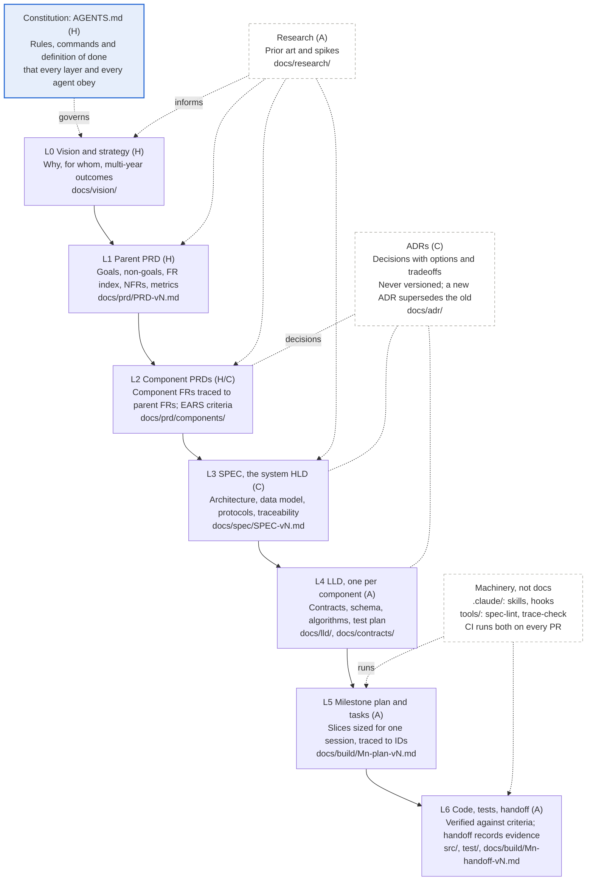
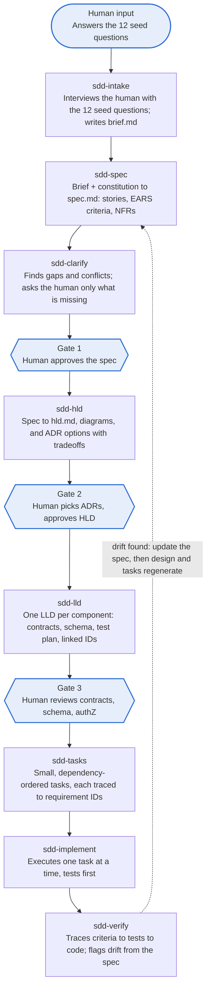

# Spec-Driven Development: Human vs Agent Ownership (v5)

Oct 20, 2026 · Kenny

## Bottom line

Humans write what cannot be derived (intent, boundaries, invariants, and irreversible decisions); agents write everything that can be derived from those answers, and humans approve at three gates: spec, HLD, and LLD. The human share shrinks as you move down the stack, from mostly human in the PRD to mostly agent in the LLD, but approval never drops to zero where a mistake is expensive to undo (public contracts, persisted schema, security paths).

The main failure mode in current tools is volume, not quality: agents generate more markdown than anyone will review, so every artifact below is kept short and each section has one owner.

## Ownership tiers

Every section in the tables below carries one of three tags.

| Tag | Who writes | Who decides | Agent may |
| --- | --- | --- | --- |
| **H** Human-authored | Human (agent may interview to capture it) | Human | Ask questions, reformat; never invent content |
| **C** Co-authored | Agent drafts options or a first pass | Human picks, edits, signs off | Propose 2 to 3 options with tradeoffs |
| **A** Agent-generated | Agent, derived from H and C sections | Human reviews at the gate, or only on exception | Regenerate freely when upstream changes |

One layer sits above all the documents: the **constitution** (Spec Kit's term; Kiro calls it steering). It holds org standards, the approved stack, security rules, and coding conventions. It is human-owned, written once per repo or org, and reused by every spec.

## Document layers

Each layer derives from the one above, and every requirement ID cites its parent, so a check can walk from a vision outcome down to a passing test. FR and NFR are sections inside the PRDs rather than layers of their own, and ADRs are decisions recorded at whatever layer makes them (most at the HLD). When the SPEC is the system-wide technical spec, it plays the HLD role, so the layer below it is per-component LLDs rather than a second HLD.



Example trace, one ID per layer: FR-3 (parent PRD) → AUTH-2 (component PRD) → SPEC 4.2 → LLD-auth section 3 → M2 task 4 → the test that cites AUTH-2.

## PRD / Spec (the what and why)

The PRD is the most human document: about half its sections are H. It stays functional; no stack or design choices belong here.

| Section | Owner | Note |
| --- | --- | --- |
| Problem statement, why now | H | The one thing an agent cannot know |
| Outcomes and success metrics (with targets) | H | Numbers and dates come from people |
| Users, personas, top jobs to be done | H | Agent can interview stakeholders to capture |
| Scope: in, out, non-goals | H | Prevents agent scope creep |
| Invariants: what must never happen | H | Security, compliance, data handling |
| NFR targets (latency, availability, scale, residency) | H | Values are human; agent writes them as testable statements |
| Fixed constraints (deadline, vendors, platforms) | H | |
| User stories | C | Human names the stories; agent writes them out |
| Acceptance criteria (EARS, or Given/When/Then) | A | Derived per story, EARS by default (see below); human reviews at Gate 1 |
| Edge cases and error behavior | A | Human spot-checks |
| Assumptions and open questions | A | Agent surfaces; human resolves before Gate 1 |
| Glossary, requirement IDs, traceability | A | |

For larger efforts, use a parent PRD plus component PRDs that reference each other by requirement ID.

## EARS notation for acceptance criteria

Use EARS as the default notation for acceptance criteria so the spec linter can check each one by its keyword. Given/When/Then (Gherkin, from BDD) is an accepted alternative, and the better fit when criteria will run as executable scenarios in a BDD tool such as Cucumber. Pick one notation per spec rather than mixing them, so criteria stay easy to lint and trace.

| Pattern | Keyword | Template | Example |
| --- | --- | --- | --- |
| Ubiquitous | (none) | The *system* shall *response*. | The authorization service shall log every allow and deny decision with its policy ID. |
| Event-driven | When | When *trigger*, the *system* shall *response*. | When a user's role is revoked, the authorization service shall invalidate that user's cached grants within 60 seconds. |
| State-driven | While | While *state*, the *system* shall *response*. | While the policy store is unreachable, the authorization service shall deny all write requests. |
| Unwanted behavior | If / then | If *condition*, then the *system* shall *response*. | If a request carries an expired token, then the authorization service shall return 401 and record the attempt. |
| Optional feature | Where | Where *feature is included*, the *system* shall *response*. | Where step-up authentication is enabled, the authorization service shall require MFA for admin actions. |
| Complex | Combined | While *state*, when *trigger*, the *system* shall *response*. | While a session is active, when its token expires, the authorization service shall deny the request and return 401. |

Each criterion states one response, names the system as the subject, and is testable as written; the numbers in the examples are illustrative.

**Given/When/Then alternative.** The event-driven example in Gherkin form:

```gherkin
Given a user holds the Approver role
When that role is revoked
Then the authorization service invalidates the user's cached grants within 60 seconds
```

## HLD (the shape of the solution)

The HLD is where humans shift from authoring to deciding: the agent drafts options, and the human chooses among them.

| Section | Owner | Note |
| --- | --- | --- |
| Architecture principles, approved stack | H | Lives in the constitution, not per spec |
| Key decisions as ADRs (build vs buy, sync vs async, data store, tenancy) | C | Agent lays out options and tradeoffs; human decides |
| Trust boundaries and authorization model | C | Human decides; agent drafts the threat model |
| System context and boundaries | C | Agent drafts; human confirms what is in and out |
| Integrations and external dependencies | C | Human confirms owners, SLAs, and access |
| Rollout and migration strategy | C | Human sets risk tolerance; agent plans phases |
| Component breakdown and responsibilities | A | |
| Data flow and sequence diagrams | A | |
| Capacity and scaling estimates | A | Derived from the NFR targets |
| Risks and mitigations | A | Human ranks them at Gate 2 |

Watch for over-specification: if the HLD restates the PRD in different words, cut it.

## LLD (the build detail, one per component)

The LLD is almost entirely agent-generated; humans review only the parts that are costly to reverse.

| Section | Owner | Human review? |
| --- | --- | --- |
| API contracts (OpenAPI, proto, events) | A | **Yes** for any public or cross-team contract |
| Data model, schema, migrations | A | **Yes** for anything persisted |
| AuthN/AuthZ enforcement points | A | **Yes**, always |
| Module structure, interfaces, algorithms | A | No, review the code instead |
| Error handling, retries, idempotency | A | Spot-check |
| Config and feature flags | A | No |
| Observability: metrics, logs, alerts | A | Thresholds trace to NFRs; no separate review |
| Test plan, cases mapped to acceptance criteria | A | Check coverage, not each case |
| Task list (dependency-ordered, traced to requirement IDs) | A | Skim at Gate 3 |

Each component LLD links back to its parent HLD section and the requirement IDs it satisfies.

## The seed questions

Yes: twelve answers are enough to derive the rest. Every H section above maps to one of these; the agent asks follow-ups only when an answer is missing or two answers conflict.

| # | Question | Feeds |
| --- | --- | --- |
| 1 | What problem are we solving, for whom, and why now? | PRD problem, personas |
| 2 | What does success look like in numbers, and by when? | Metrics, deadline |
| 3 | What are the top three things users must be able to do? | User stories, then ACs |
| 4 | What is explicitly out of scope? | Non-goals |
| 5 | What must never happen? | Invariants, threat model, security tests |
| 6 | What are the latency, availability, scale, and residency targets? | NFRs, capacity, alerts |
| 7 | What data does it touch, and how is it classified? | Data model, controls |
| 8 | What systems must it integrate with or replace, and who owns them? | Context, integrations |
| 9 | What is already fixed (stack, vendors, platforms, budget)? | Constitution check, ADR limits |
| 10 | Which decisions are already made, and which are open? | ADR options |
| 11 | What is the rollout risk tolerance (flags, canary, rollback)? | Rollout plan |
| 12 | How will we know it is done (demo, test, metric)? | Test plan, Definition of Done |

Questions 9 and 10 are usually answered once in the constitution and only revisited per spec when something changes.

## Tooling and skills to build

Build eight small skills that run in sequence, with a hard stop at each human gate; extend Spec Kit's commands and templates rather than starting from scratch, since it already runs in Claude Code and is fully customizable. Humans enter the chain at four points (shaded); agents do the rest.



The loop back from sdd-verify to sdd-spec is what makes the spec a living artifact (spec-anchored) instead of a throwaway prompt.

| Supporting piece | Purpose |
| --- | --- |
| constitution.md | Human-owned standards every skill reads first |
| Templates per artifact | Fixed sections tagged H, C, or A, so the agent cannot skip or invent sections |
| Spec linter | Fails on missing requirement IDs, criteria not in an EARS pattern or Given/When/Then form, untestable criteria, or unresolved open questions |
| Gate hook | Blocks the next skill until the prior artifact is marked approved |
| Size router | Sends bugs and small changes down a short path (spec plus tasks only) |
| Traceability check in CI | Every acceptance criterion has a test; every task cites an ID |

## Repository layout

The rule of thumb: `docs/` holds what humans review (the what and why), `.claude/` and `tools/` hold what agents run (the how), and `AGENTS.md` at the root is the bridge every agent loads first.

```text
repo/
├── AGENTS.md                      constitution: rules, commands, definition of done (H)
├── CLAUDE.md                      one line: @AGENTS.md
├── docs/
│   ├── README.md                  doc map: layers, latest version of each, ID scheme
│   ├── vision/vision-vN.md        L0 vision and strategy
│   ├── research/<topic>-vN.md     inputs to L0 to L3
│   ├── prd/PRD-vN.md              L1 parent: goals, FR index, NFRs, metrics
│   ├── prd/components/PRD-<c>-vN.md   L2: component FRs, EARS criteria
│   ├── adr/NNNN-<decision>.md     decisions; never versioned, superseded instead
│   ├── spec/SPEC-vN.md            L3 system HLD + PRD-to-spec traceability
│   ├── lld/LLD-<c>-vN.md          L4, one per component
│   ├── contracts/                 OpenAPI, JSON Schema, tool schemas
│   ├── test/test-plan-vN.md       criteria-to-test matrix
│   ├── build/M<n>-{kickoff,plan,handoff}-vN.md   L5 plans and tasks, L6 evidence
│   ├── runbooks/<task>-vN.md      ops procedures
│   ├── templates/                 one per artifact, sections tagged H, C, A
│   ├── glossary.md
│   └── assets/diagrams/           Mermaid sources + rendered SVGs
├── .claude/                       Claude Code machinery, versioned with the code
│   ├── skills/sdd-*/SKILL.md      the eight SDD skills
│   ├── agents/                    reviewer and verifier subagents
│   ├── commands/                  slash commands that wrap the skills
│   └── settings.json              hooks, including the gate hook
├── .claude-plugin/                packages the skills for other repos and machines
├── tools/
│   ├── spec-lint/                 IDs, EARS or Given/When/Then, open questions
│   └── trace-check/               every criterion has a test, every task an ID
└── .github/workflows/ci.yml       typecheck, tests, spec-lint, trace-check
```

**Where the machinery goes.**

| Thing | Home | Why |
| --- | --- | --- |
| Rules | `AGENTS.md`, with long topic rules split into files it links to | Every agent loads it; Codex reads `AGENTS.md`, Claude Code reaches it through `CLAUDE.md` |
| Skills | `.claude/skills/`, packaged through `.claude-plugin/` for reuse | Where Claude Code discovers them; the plugin carries them to other repos |
| Loops | Inside the skill or command that runs them; the stop condition goes in the definition of done | A loop is behavior, not a document |
| Verification | Scripts in `tools/`, run by CI; evidence in `docs/build/*-handoff` | The check is code; the record of what passed is a document |
| Templates | `docs/templates/` | Humans review the section list and the H, C, A tags |

**Conventions that keep the tree traceable.**

1. Every versioned document is `<name>-vN.md`; past versions are never edited, the next number is created instead.
2. ADRs are the exception: numbered once, with a Status line, and superseded by a new ADR rather than versioned.
3. `docs/README.md` lists the latest version of each document, so agents never have to search for it.
4. Every acceptance criterion has an ID that its test cites, which is what `trace-check` matches.

## Sources

- [Understanding Spec-Driven Development: Kiro, spec-kit, and Tessl](https://www.martinfowler.com/articles/exploring-gen-ai/sdd-3-tools.html), Birgitta Böckeler (levels of SDD, review overload, sizing)
- [Spec-driven development with AI: Spec Kit launch](https://github.blog/2025-09-02-spec-driven-development-with-ai-get-started-with-a-new-open-source-toolkit/), GitHub (constitution, steer and verify)
- [Kiro Specs: Requirements to Code](https://www.verdent.ai/guides/agents/kiro-spec-driven-development) (requirements, design, tasks; EARS; over-specification signal)
- [spec-driven-development skill](https://hackernoon.com/skills/addyosmani-spec-driven-development), Addy Osmani (human gate per phase, task sizing)
- [What Is the BMAD Method?](https://www.augmentcode.com/guides/bmad-method-ai-development) (Analyst, PM, Architect roles; brief to PRD to architecture)
- [spec-driven-development skill](https://tessl.io/registry/kevin-ryan-io/spec-driven-development/files/SKILL.md), Tessl registry (brief as the spec for the spec)
