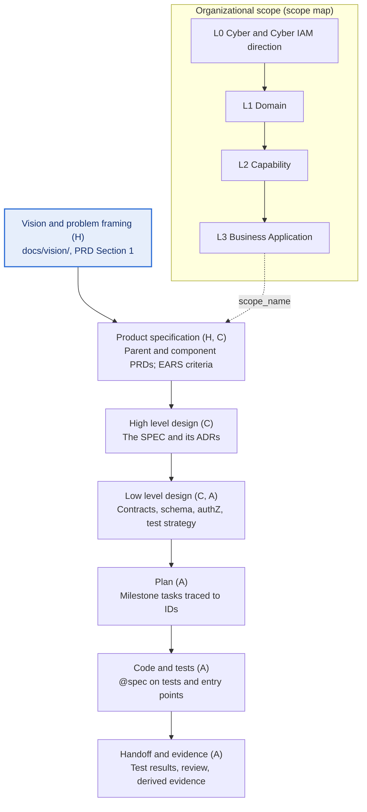
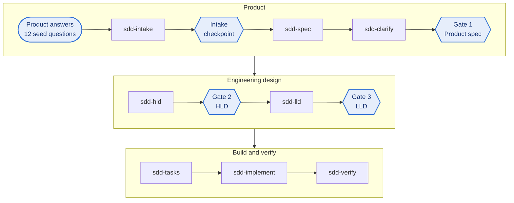

# Spec-Driven Development: Human vs Agent Ownership (v14)

Oct 22, 2026 · Kenny

## Bottom line

Spec-driven development (SDD) is a controlled bridge from Product intent to Engineering delivery. Product owns the problem, outcomes, scope, priorities, constraints and acceptance. Engineering contributes feasibility and risk input while intent is formed, then owns architecture and implementation. When implementation reveals a choice that changes approved behavior, the choice goes back to Product.

People make every decision that cannot be derived: intent, boundaries, invariants, and choices that are expensive to reverse. Agents prepare everything else from approved inputs, as drafts for a person to select or as derived material. People approve at an intake checkpoint and three gates. The human share shrinks down the chain, but it never reaches zero where a mistake is hard to undo: requirements and criteria, public contracts, persisted schema, authorization and the test strategy.

The main failure mode in current tools is volume, not quality: agents generate more text than anyone will review. Every artifact stays short, and each section has one decision owner.

Links between artifacts are plain text that a script can follow: stable requirement IDs, cited by `@spec` comments in tests and code, checked in CI. The checks prove that structural links exist; they do not prove that a test checks what a criterion means, so review remains required (see [Linking and tracking intent](#linking-and-tracking-intent)).

**Reusable toolkit, reference profile.** The framework is a reusable toolkit. Its portable core is the same everywhere: templates with decision owners, human gates, stable IDs and their lifecycle, structural trace checks, and change control. Each adopting organization adapts the local choices. It ships with an Access Management reference profile: Access Management is the example L1 domain under Cyber IAM where the toolkit is piloted. The worked example is synthetic and selects no pilot capability or application.

## Three separate concepts

Version 13 used L0 to L6 for document stages. That collided with the organizational scope levels, so v14 keeps three ideas apart.

| Concept | Values | Answers |
| --- | --- | --- |
| Organizational scope | L0, L1, L2, L3 | Which part of the organization an artifact serves |
| Delivery artifact chain | Artifact types, unnumbered | Which artifact derives from which |
| Gates | Intake checkpoint, Gate 1, Gate 2, Gate 3 | Which human approval an artifact needs |

Gates 1, 2 and 3 do not correspond to scope levels L1, L2 and L3. HLD and LLD are artifact types, not organizational levels.

**Organizational scope.**

| Level | Meaning |
| --- | --- |
| L0 | Cyber and Cyber IAM strategy, declarations and imperatives |
| L1 | Domain (Access Management in the reference profile) |
| L2 | Solution or capability, such as entitlement management or access certification |
| L3 | Business Application |

A scope map (`docs/scope/scope-map.yaml`) names each scope, its parent one level up, and its owner. Documents record `scope_level` and `scope_name`. A scope parent (an organizational unit) and a trace parent (`derives_from`, an artifact) are different relationships.

## Decision ownership

Every section in the tables below carries one of three tags.

| Tag | Meaning | Who decides | Agent may |
| --- | --- | --- | --- |
| **H** Human decision | A person supplies and approves the content | The owner | Interview, organize and edit; never invent |
| **C** Human decision with agent draft | An agent drafts options and exposes assumptions, sources and tradeoffs | A person selects and approves | Draft two or three options |
| **A** Agent prepared from approved inputs | An agent prepares it; reviewed at the gate or on exception | The gate reviewer | Prepare and regenerate it; never change approved intent; it must pass the checks |

Every **A** and **C** section names the **agent persona** that drafts it; **H** sections have none, though the `analyst` may interview the owner to capture them. Personas are in [Agent personas](#agent-personas).

| Role | Owns | Contributes |
| --- | --- | --- |
| Product | Problem, outcomes, scope, priorities, constraints, acceptance; approves the intake checkpoint and Gate 1 | Confirms any design choice that changes approved outcomes or behavior |
| Engineering | Architecture and implementation; approves Gate 2; with component and control owners, approves Gate 3 | Feasibility, dependency and risk input while intent is formed |
| Agents | Nothing accountable | Bounded, traceable drafts and derived material from approved inputs |

One file sits above all the documents: **`AGENTS.md`**, the repository instructions. It holds the rules, the approved stack, commands and the definition of done, and it points every person and agent to the standard, the scope map and the artifact index. It is human-owned, but it is not organizational authority by itself: the controlled standard and its approver are an open decision.

## The delivery artifact chain

Each artifact derives from the one above it, and every requirement ID cites its parent. FR and NFR are sections inside the PRDs, and ADRs are decisions recorded where they are made (most at the high level design). The SPEC is the system high level design, so the artifact below it is one LLD per component.



SVG version: [diagrams/sdd-artifact-chain-v14.svg](diagrams/sdd-artifact-chain-v14.svg)

| Artifact type | Folder | Decision owner | Approved at |
| --- | --- | --- | --- |
| Vision and problem framing | `docs/vision/`, PRD Section 1 | Product (H) | Intake checkpoint |
| Product specification | `docs/prd/`, `docs/prd/components/` | Product (H, C) | Gate 1 |
| High level design | `docs/spec/`, `docs/adr/` | Engineering (C) | Gate 2 |
| Low level design | `docs/lld/`, `docs/contracts/`, `docs/test/` | Engineering, component and control owners (C, A) | Gate 3 |
| Plan | `docs/build/` | Engineering (A) | |
| Code and tests | `src/`, `test/` | Engineering (A) | Code review |
| Handoff and evidence | `docs/build/`, `docs/trace/` | Derived (A) | Code review |

Example trace, one ID per artifact: FR-3 (parent PRD), IAM-2 (component PRD), SPEC 4.2, LLD-iam section 3, task M1-3, then the test and the code entry point that carry `// @spec IAM-2`.

## Product specification (the what and why)

The PRD is the most human document. It stays functional: no stack or design choices belong here.

| Section | Owner | Persona | Note |
| --- | --- | --- | --- |
| Problem statement, why now | H | none (`analyst` may interview) | The one thing an agent cannot know |
| Outcomes and success metrics (with targets) | H | none | Numbers and dates come from people |
| Users, personas, top jobs to be done | H | none (`analyst` may interview) | |
| Scope: in, out, non-goals | H | none | Prevents agent scope creep |
| Invariants: what must never happen | H | none | Security, compliance, data handling |
| NFR targets (latency, availability, scale, residency) | H | none (`product-writer` makes them testable) | Values are human |
| Fixed constraints (deadline, vendors, platforms) | H | none | |
| Organizational scope (`scope_level`, `scope_name`) | H | none | Which L0 to L3 scope the product serves |
| User stories | C | `product-writer` | Human names the stories; agent writes them out |
| Story priority (P1 to P3), with a one-line reason | H | none (`product-writer` may propose) | Sets the MVP and the build order |
| Functional requirements and acceptance criteria (EARS, or Given/When/Then) | C | `product-writer` | Agent drafts as options; the owner selects and approves at Gate 1 |
| ID history (withdrawn, superseded, split, merged IDs) | C | `product-writer` | Agent records; the owner confirms |
| Edge cases and error behavior | A | `product-writer` | Human spot-checks |
| Assumptions and open questions | A | `product-writer` | Agent surfaces; human resolves before Gate 1 |
| Glossary | A | `product-writer` | |
| Research and prior art feeding the PRD | A | `analyst` | Linked sources only; never decides |

For larger efforts, use a parent PRD plus component PRDs that reference each other by requirement ID.

## EARS notation for acceptance criteria

Use EARS as the default notation so the spec linter can check each criterion by its keyword. Given/When/Then (Gherkin) is an accepted alternative, and the better fit when criteria run as executable scenarios in a BDD tool. Pick one notation per document.

| Pattern | Keyword | Template | Example |
| --- | --- | --- | --- |
| Ubiquitous | (none) | The *system* shall *response*. | The authorization service shall log every allow and deny decision with its policy ID. |
| Event-driven | When | When *trigger*, the *system* shall *response*. | When a user's role is revoked, the authorization service shall invalidate that user's cached grants within 60 seconds. |
| State-driven | While | While *state*, the *system* shall *response*. | While the policy store is unreachable, the authorization service shall deny all write requests. |
| Unwanted behavior | If / then | If *condition*, then the *system* shall *response*. | If a request carries an expired token, then the authorization service shall return 401 and record the attempt. |
| Optional feature | Where | Where *feature is included*, the *system* shall *response*. | Where step-up authentication is enabled, the authorization service shall require MFA for admin actions. |
| Complex | Combined | While *state*, when *trigger*, the *system* shall *response*. | While a session is active, when its token expires, the authorization service shall deny the request and return 401. |

Each criterion states one response, names the system as the subject, is testable as written, and carries a priority. The numbers in the examples are illustrative.

**Given/When/Then alternative.** The event-driven example in Gherkin form:

```gherkin
Given a user holds the Approver role
When that role is revoked
Then the authorization service invalidates the user's cached grants within 60 seconds
```

## High level design (the shape of the solution)

At the high level design, people shift from authoring to deciding: an agent drafts options, and Engineering chooses among them.

| Section | Owner | Persona | Note |
| --- | --- | --- | --- |
| Architecture principles, approved stack | H | none | Lives in `AGENTS.md`, not per spec |
| Key decisions as ADRs (build vs buy, sync vs async, data store, tenancy) | C | `architect` | Agent lays out options and tradeoffs; Engineering decides |
| Trust boundaries and authorization model | C | `security-reviewer` | Control owner decides; agent drafts the threat model |
| System context and boundaries | C | `architect` | |
| Integrations and external dependencies | C | `architect` | Human confirms owners, SLAs and access |
| Rollout and migration strategy | C | `sre` | Human sets risk tolerance; agent plans phases |
| Testing strategy | C | `test-architect` | Layers and tooling; approved at Gate 2 |
| Component breakdown and responsibilities | A | `architect` | |
| Data flow and sequence diagrams | A | `architect` | |
| Capacity and scaling estimates | A | `architect` | Derived from the NFR targets |
| Risks and mitigations | A | `architect` | Engineering ranks them at Gate 2 |

Watch for over-specification: if the high level design restates the PRD in different words, cut it.

## Low level design (the build detail, one per component)

Agents prepare most of the LLD from the approved SPEC. The decisions that are costly to reverse are drafted as options and decided by people at Gate 3.

| Section | Owner | Persona | Decided by |
| --- | --- | --- | --- |
| Public and cross-team contracts (OpenAPI, proto, events) | C | `component-designer` | The contract owner |
| Data model, persisted schema, migrations | C | `component-designer` | The component owner |
| AuthN and AuthZ enforcement points | C | `security-reviewer` | The control owner |
| Test strategy: every criterion mapped to planned tests | C | `test-architect` | The component owner |
| Module structure, interfaces, algorithms | A | `component-designer` | Reviewed through the code |
| Error handling, retries, idempotency | A | `component-designer` | Spot-check |
| Config and feature flags | A | `component-designer` | |
| Observability: metrics, logs, alerts | A | `sre` | Thresholds trace to NFRs |
| Task list (dependency-ordered, traced to criterion IDs) | A | `planner` | Skim after Gate 3 |
| Code, tests and handoff | A | `implementer` | Code review; `verifier` checks the trace |

Each LLD links back to its SPEC section and the criterion IDs it satisfies. For an existing codebase, rationale inferred from the code is tagged `[inferred]` until the owner confirms it.

## The seed questions

Twelve answers are enough to derive the rest. Every H section above maps to one of them; the agent asks follow-ups only when an answer is missing or two answers conflict.

| # | Question | Feeds |
| --- | --- | --- |
| 1 | What problem are we solving, for whom, and why now? | PRD problem, personas |
| 2 | What does success look like in numbers, and by when? | Metrics, deadline |
| 3 | What are the top three things users must be able to do, in priority order? | User stories and their priorities, then criteria |
| 4 | What is explicitly out of scope? | Non-goals |
| 5 | What must never happen? | Invariants, threat model, security tests |
| 6 | What are the latency, availability, scale, and residency targets? | NFRs, capacity, alerts |
| 7 | What data does it touch, and how is it classified? | Data model, controls |
| 8 | What systems must it integrate with or replace, and who owns them? | Context, integrations |
| 9 | What is already fixed (stack, vendors, platforms, budget)? | `AGENTS.md`, ADR limits |
| 10 | Which decisions are already made, and which are open? | ADR options |
| 11 | What is the rollout risk tolerance (flags, canary, rollback), and who responds when it fails? | Rollout plan, support owners and response targets |
| 12 | How will we know it is done (demo, test, metric)? | Test strategy, definition of done |

Questions 9 and 10 are usually answered once in `AGENTS.md`. The organizational scope is asked alongside question 1 and recorded from the scope map.

## Checkpoints and gates

| Checkpoint | What is approved | Approver (default role) | What it unlocks |
| --- | --- | --- | --- |
| Intake checkpoint | The problem framing (PRD Section 1) | Product authority | Requirements work |
| Gate 1 | The Product specification, parent and component | Product authority, with feasibility and control reviewers | High level design; low level design for that component |
| Gate 2 | The SPEC and its chosen ADRs | Engineering authority; Product confirms any effect on approved outcomes | Low level design |
| Gate 3 | The LLD: contracts, schema, authorization, test strategy | Business Application, component and control owners | Planning and build for that component |

The intake checkpoint is a local control of the reference profile, outside the three formal gates. It replaces what v13 called Gate 0.

**Recording an approval.** A person sets `status: approved` and records `approved_by` (name and role) and `approved` (date). Agents never set them.

**Binding.** Each gate applies to one component. `sdd-lld iam` needs the SPEC and the `iam` component PRD approved. `sdd-tasks iam` needs the `iam` LLD. `sdd-implement M1` needs the M1 plan and an approved LLD for every component it covers.

**Limits.** Front matter is self-asserted: a hook can read `approved_by` but cannot prove who that person is. Approver authority comes from repository controls: `CODEOWNERS`, branch protection that requires their review, and the pull request record. Named approvers, the exception authority, fast path criteria and audit timing are open decisions for each adopting organization.

## Priority and severity

Product priority and operational severity are separate decision lenses. Each has its own scale and labels, so a P1 story is never confused with an S1 incident.

### Product priority

| Priority | Meaning | Example | Delivery rule |
| --- | --- | --- | --- |
| **P1** | Must ship for the release to have value (the MVP) | A user's revoked role stops granting access | First milestone; cannot be deferred |
| **P2** | Should ship; the release has value without it | Bulk role revocation | After P1; may be deferred with approval |
| **P3** | Could ship; nice to have | Export of revocation history | Backlog; re-ranked at each milestone |

1. The owner sets a priority on every user story, with a one-line reason (H). The `product-writer` may propose; the owner decides at Gate 1.
2. Acceptance criteria inherit their story's priority. NFRs and invariants are always P1.
3. The `planner` orders milestones by priority, then by dependency. Foundational work that blocks a P1 story is itself P1.
4. Only P2 and P3 criteria may be deferred. A P1 criterion can only be excepted, by the exception authority, with the reason recorded in the approved test strategy.
5. Re-ranking a story is a change to the PRD (its next version), not an edit to the task list.

### Operational severity

| Severity | Urgency | Impact | Example | Response | Path |
| --- | --- | --- | --- | --- | --- |
| **S0** | Critical | Extensive | System outage, or any breach of a PRD invariant | Immediate | Runbook now; fast path fix; postmortem |
| **S1** | High | Large | Major feature malfunctioning | Urgent, within the normal schedule | Fast path; postmortem |
| **S2** | Moderate | Moderate | Minor feature malfunctioning | Ranked against other work | Normal change |
| **S3** | Low | Minor | A feature blocks a few users | Part of routine work | Normal change, from the backlog |
| **S4** | Negligible | Negligible | Cosmetic issue with no effect on users | Backlog | Backlog |

| Type | What it is | Triaged by | Fix likely starts at |
| --- | --- | --- | --- |
| Failure | Outage, degradation or failed deploy | `sre` | Runbook first, then the first artifact that lost intent |
| Bug | Behavior violates an existing, unchanged criterion | `verifier` | Code, with a reproducing test that cites the criterion |
| Spec gap | Behavior that no criterion covers, or a criterion that is wrong | `verifier` | The PRD or LLD; new capability becomes delivery work with a P rank |
| Blocker | Something that stops delivery: failing CI, missing access, an unanswered H question, an external dependency | `planner` | Whoever owns the blocking item |
| Drift | Two artifacts in the trace disagree | `verifier` | The first artifact the owner says lost intent |

1. The triage agent assigns type and severity and cites the affected criterion IDs. A person confirms every S0 and S1 and can override any severity.
2. A breach of a PRD invariant or a security criterion is S0 or S1, whatever its reach. A blocker takes the severity of the work it blocks.
3. The owner names where the fix starts (see [Drift and fixes](#drift-and-fixes)). The fast path combines the gates into one human review; it does not skip the trace.
4. S0 and S1 incidents get a postmortem in `docs/postmortems/`, drafted by the `sre` and approved by the owner.

### Combined queue (a local choice)

The portable core does not require one queue; adopting organizations can map both lenses into their own portfolio and incident processes. The reference profile tests a combined ordering, kept by the `planner`:

**S0 > S1 > P1 > S2 = P2 > S3 = P3 > S4**

S0 interrupts work in flight. Everything else is taken in order at the next task boundary, and equal ranks are ordered by dependency.

## Agent personas

A persona is a named, scoped role an agent plays when it drafts or reviews part of a document. Eleven cover every A and C section above. The full standard is `docs/standards/agent-personas-v1.md`.

| Persona | Prepares (A) | Drafts for a decision (C) | Checkpoint |
| --- | --- | --- | --- |
| `analyst` | Research, prior art, the intake record of the owner's answers | None; may interview for H sections | Before the intake checkpoint and Gate 1 |
| `product-writer` | Edge cases, assumptions, glossary | User stories, functional requirements, acceptance criteria, ID history | Gate 1 |
| `architect` | Component breakdown, data flow, capacity, risks | ADR options, system context, integrations | Gate 2 |
| `security-reviewer` | | Trust boundaries, threat model, authorization enforcement in LLDs | Gates 2 and 3 |
| `component-designer` | Module structure, algorithms, errors, config | Public contracts, persisted schema | Gate 3 |
| `test-architect` | Gaps; records deferrals and exceptions the owner decided | Testing strategy, test strategy with planned evidence per criterion | Gates 2 and 3 |
| `sre` | Observability, runbooks, triage of failures, postmortem drafts | Rollout and migration | Gates 2 and 3; S0 and S1 confirmation |
| `planner` | Milestone plans naming their components, tasks, triage of blockers, the queue | None | After Gate 3 |
| `implementer` | Code and tests with `@spec`, handoff with test results | None | Code review |
| `verifier` | Trace findings, evidence states, the audit record, optional probes; triage of bugs and drift | None | Every checkpoint (independent) |
| `doc-steward` | Doc map, glossary, version and link hygiene | None | None (mechanical) |

**Minimum requirements for every persona definition.**

1. Identity: `name` (kebab case, matches the file) and a one-sentence `description` of when to use it.
2. Purpose: one paragraph.
3. Owned sections, each tagged A or C; never an H section.
4. Inputs, in reading order: `AGENTS.md` first, then the artifact above its output.
5. Outputs: exact files and format; always the next numbered version, never an edit to a past one.
6. Tools: least privilege; reviewers are read-only plus check commands.
7. Boundaries: never invent H content, never approve or verify its own work, never edit another persona's section, cite IDs, mark assumptions.
8. Gate and handoff: which human checkpoint reviews it and who receives its output.
9. Definition of done: the checks it runs before handing off.
10. Escalation: when it stops and asks (missing or conflicting H answers, anything irreversible).
11. Version: a semantic version in `metadata.version` and a changelog row for every change.

**Where they live.** Each persona is a markdown file in `.claude/agents/<name>.md`, versioned with the code. Claude Code discovers subagents there, and `AGENTS.md` points other agents (Codex) to the same files. The standard sits in `docs/standards/`. Each template section's owner line names its persona, so assignments travel with every new document.

## Tooling and skills

Eight skills run in sequence, with a hard stop at each human checkpoint; two more cover adoption of existing code (`sdd-adopt`) and support work (`sdd-triage`). People decide at the shaded points; agents prepare the rest.



SVG version: [diagrams/sdd-skill-chain-v14.svg](diagrams/sdd-skill-chain-v14.svg)

When `sdd-verify` reports a disagreement, the owner names the first artifact that no longer reflects approved intent; that artifact is corrected, then the ones that depend on it. That loop keeps the spec a living artifact instead of a throwaway prompt.

| Supporting piece | Purpose |
| --- | --- |
| `AGENTS.md` | Repository instructions every skill reads first; points to the standard, scope map and artifact index |
| Templates per artifact | Fixed sections tagged H, C or A, so an agent cannot skip or invent sections |
| Scope map | `docs/scope/scope-map.yaml`: L0 to L3 scopes, parents and owners, checked by spec-lint |
| Spec linter | Fails on malformed front matter, criteria not in EARS or Given/When/Then form, open questions in approved documents, bad scope levels, and reused IDs |
| Gate hook | Blocks the next skill until the artifact for the named component is approved (a Claude Code adapter; other agents follow it procedurally) |
| Size router | Sends bugs and small changes down a short path; S0 and S1 always take it; a change that crosses components stops for a person |
| Traceability check (`trace-check`) | Evidence states per criterion; fails on reverse orphans, missing tests once a plan exists, failing tests and hollow status; warns on stale evidence; reports annotation reach |
| Audit record | `docs/trace/index.yaml`: per component scope, owner, audited commit, findings, disposition, drift, next action, and governing artifact versions |
| `CODEOWNERS` | Names who reviews the governed documents; with branch protection, it is what proves approver authority |

## Linking and tracking intent

A trace is only as good as the links that carry it. Links are plain text that a script can follow, tracking state lives only in derived files, and the structural checks fail the build. This section adapts Linked-Intent Development (LID); [Appendix A](#appendix-a-lid-adopted-or-not-using) lists what is adopted.

**How a link is made.**

- Every requirement keeps one stable ID for life: never renumbered and never reused.
- Tests and code cite the IDs they satisfy in a comment, on the test that exercises the behavior and on the entry point of the behavior in code, not on every helper. Each test's title also names its ID.
- `@spec` cites acceptance criterion IDs. References to SPEC or LLD sections go in the handoff, not in code.
- Every hop is then one text search, in either direction.

```ts
// @spec IAM-2
it("IAM-2: invalidates cached grants within 60 seconds of role revocation", async () => { /* ... */ });
```

**ID lifecycle.**

| Change | ID |
| --- | --- |
| Editorial clarification | Keeps its ID |
| New actor, trigger, response, measurable target, control obligation or test obligation | New ID; the old one is recorded as superseded |
| Split or merge | New IDs; the old ones are recorded as split or merged |
| Unchanged behavior moved between organizational scopes | Keeps its ID; IDs should not encode scope |
| Behavior withdrawn | Recorded as withdrawn; the ID is never reused |

Each PRD keeps an **ID history** table (`| ID | Status | Replaced by | Reason |`). The linter fails when an ID is defined in two document families or comes back after it was retired, and warns when an ID disappears without a history row. The default form is `IAM-2`; a richer form such as `AM-PRIV-001-AC1` can be allowed by configuration.

**Evidence states.**

| State | Meaning |
| --- | --- |
| `planned` | No test yet; the test strategy or LLD maps it to planned tests |
| `test linked` | A test cites it (was `covered` in v13) |
| `passing`, `failing` | A linked test ran, read from a JUnit report |
| `deferred` | The owner deferred it (P2 or P3 only), in the approved test strategy |
| `excepted` | The exception authority accepted the risk, in the approved test strategy |
| `drifted` | The verifier recorded drift for it |
| `gap` | Nothing planned or linked |

| Stage | Required |
| --- | --- |
| Before build (Gate 1 through Gate 3) | Every approved criterion is planned, deferred or excepted; a gap is a warning |
| During build (a milestone plan exists for the component) | Every approved criterion of that component is test linked, deferred or excepted; otherwise the build fails |
| At handoff | Linked tests ran and passed; the handoff records the results and the review |

**Where tracking state lives.**

| State | Home | Written by |
| --- | --- | --- |
| Evidence state per criterion | `docs/trace/coverage.md`, regenerated from the annotations | `trace-check --write` |
| Audit record per component | `docs/trace/index.yaml` | `verifier`; counts and artifact versions by `trace-check --write` |
| Differential audit records | `docs/trace/audits/<component>/<ID>.md` | `verifier` |

Status never goes inside a versioned document, because past versions are frozen. The approved test strategy holds only owner decisions: planned evidence, deferrals and exceptions.

**Structural checks.** `trace-check` runs in CI. It fails on reverse orphans, on an approved criterion with no test once a plan exists for its component, on a failing linked test, on hollow status, and on a deferred P1. It warns when evidence is stale: when code changed since the last audit, or when a governing PRD, SPEC, LLD or test strategy was approved or changed after it. Checks across the rest of the chain (L0 direction to handoff) are planned; today the doc map shows those links.

**Annotation reach.** The checks see only what is annotated, and the agent that writes the code also places the annotations, so under-annotating is the cheapest way to pass. Reach is reported on every pull request, and a falling number is a code review finding.

**Semantic verification.** Structural checks prove that links exist, not that the linked things agree. Two optional verifier modes, each behind a feature flag, use readers with no context:

- Divergence probe (in `sdd-clarify`, before Gate 1): blind readers give two or three plausible readings of each new criterion; every genuine fork goes back to the owner.
- Bidirectional differential (in `sdd-verify`): some blind sessions implement the criterion from its text alone while others reconstruct the criterion from the stripped code, and the two are compared by behavior.

LID's own trial caught 23 of 24 planted gaps on annotated code and missed the one gap in unannotated code. Its critique notes a single codebase, a small sample and no human baseline, so treat the differential as an aid to review, not a replacement for it.

## Drift and fixes

Verification reports a disagreement. The named human owner determines the first artifact in the delivery trace that no longer reflects approved intent. The team corrects that artifact, then updates or regenerates its dependent artifacts.

This permits a code-first fix when code breaks an unchanged criterion, and it sends a flawed requirement or design back to its accountable owner. v13 always started at the spec.

**Cascade.** A change inside one component cascades to its LLD, tests and code in the same change. A change that crosses components stops for a person and goes into the next SPEC version, with an ADR when the system's shape changes.

**Rules for `AGENTS.md`.**

- Memory vs intent: knowledge an agent would need in its next session goes into the docs, not into an agent's private memory.
- Placement: each decision and term lives in the lowest artifact or component that covers everything it affects.

## Repository layout

`docs/` holds what people review (the what and why), `.claude/` and `tools/` hold what agents run (the how), and `AGENTS.md` at the root is the entry point every agent loads first.

```text
repo/
├── AGENTS.md                               # Repository instructions: rules, commands, definition of done (H)
├── CLAUDE.md                               # One line: @AGENTS.md
├── sdd.config.json                         # Components, ID prefixes, scope, paths, approvals, feature flags
├── docs/                                   # What people review: the what and why
│   ├── README.md                           # Doc map: scope map, artifact index, approval workflow
│   ├── glossary.md                         # Framework and domain terms
│   ├── scope/
│   │   └── scope-map.yaml                  # L0 to L3 organizational scopes, parents, owners (H)
│   ├── vision/                             # Vision and problem framing (H)
│   │   └── vision-v1.md
│   ├── research/                           # Findings that inform the specification and designs (A)
│   │   └── iam-token-storage-v1.md
│   ├── prd/                                # Product specification
│   │   ├── PRD-v1.md                       # Parent: outcomes, FR index, NFRs, invariants (H)
│   │   └── components/                     # Component PRDs: EARS criteria, ID history (H, C)
│   │       ├── PRD-iam-v1.md
│   │       └── PRD-billing-v1.md
│   ├── adr/                                # Decisions; superseded, never versioned (C)
│   │   ├── README.md                       # ADR index and statuses
│   │   ├── 0001-use-postgresql.md
│   │   └── 0002-jwt-token-revocation.md
│   ├── spec/                               # High level design and PRD-to-spec traceability (C)
│   │   └── SPEC-v1.md
│   ├── lld/                                # Low level design, one per component (C, A)
│   │   ├── LLD-iam-v1.md
│   │   └── LLD-billing-v1.md
│   ├── contracts/                          # Interface specs, data models, tool definitions (C)
│   │   ├── openapi.yaml
│   │   ├── session-event.schema.json
│   │   └── agent-tools.json
│   ├── test/                               # Test strategy: planned evidence, deferrals, exceptions (C)
│   │   └── test-plan-v1.md
│   ├── trace/                              # Derived evidence; never versioned
│   │   ├── coverage.md                     # Evidence state per criterion
│   │   ├── index.yaml                      # Audit record per component
│   │   └── audits/
│   │       └── iam/
│   │           └── IAM-2.md                # Differential audit record
│   ├── build/                              # Plans and handoffs (A)
│   │   ├── M1-kickoff-v1.md
│   │   ├── M1-plan-v1.md
│   │   └── M1-handoff-v1.md
│   ├── runbooks/                           # Operational procedures (A)
│   │   └── db-failover-v1.md
│   ├── postmortems/                        # Reviews of S0 and S1 incidents (C)
│   │   └── 2026-03-14-token-cache-outage.md
│   ├── templates/                          # One per artifact; sections tagged H, C or A with persona
│   │   ├── PRD-template.md
│   │   ├── PRD-component-template.md
│   │   ├── SPEC-template.md
│   │   ├── LLD-template.md
│   │   └── test-plan-template.md
│   ├── standards/                          # The standard and the persona standard
│   │   ├── spec-driven-development-v2.md
│   │   └── agent-personas-v1.md
│   ├── guide/                              # Overview, setup, usage, tools, other agents, versioning, catalog
│   └── assets/
│       └── diagrams/
│           ├── sdd-doc-layers.svg          # The artifact chain beside the scope map
│           ├── sdd-skill-chain.svg
│           ├── iam-sequence.mmd
│           └── iam-sequence.svg
├── .claude/                                # What agents run, versioned with the code
│   ├── skills/                             # Ten skills: the eight-step chain, sdd-adopt, sdd-triage
│   │   ├── sdd-intake/
│   │   │   └── SKILL.md
│   │   ├── sdd-spec/
│   │   │   └── SKILL.md
│   │   ├── sdd-clarify/
│   │   │   └── SKILL.md
│   │   ├── sdd-hld/
│   │   │   └── SKILL.md
│   │   ├── sdd-lld/
│   │   │   └── SKILL.md
│   │   ├── sdd-tasks/
│   │   │   └── SKILL.md
│   │   ├── sdd-implement/
│   │   │   └── SKILL.md
│   │   ├── sdd-verify/
│   │   │   └── SKILL.md
│   │   ├── sdd-adopt/
│   │   │   └── SKILL.md
│   │   └── sdd-triage/
│   │       └── SKILL.md
│   ├── agents/                             # One file per persona
│   │   ├── analyst.md
│   │   ├── product-writer.md
│   │   ├── architect.md
│   │   ├── security-reviewer.md
│   │   ├── component-designer.md
│   │   ├── test-architect.md
│   │   ├── sre.md
│   │   ├── planner.md
│   │   ├── implementer.md
│   │   ├── verifier.md
│   │   └── doc-steward.md
│   ├── commands/
│   │   ├── sdd-new.md                      # Starts a spec: sdd-intake, then sdd-spec
│   │   ├── sdd-check.md                    # Runs spec-lint and trace-check
│   │   └── sdd-status.md                   # Where each component stands, the next checkpoint
│   └── settings.json                       # Gate and protect-approved hooks
├── .claude-plugin/                         # Packages the skills, personas and hooks
│   ├── plugin.json
│   └── marketplace.json
├── tools/                                  # Executable checks and the sdd command line
│   ├── lib/                                # Shared rules: IDs, front matter, components
│   ├── spec-lint/                          # Documents, scope map, ID lifecycle
│   ├── trace-check/                        # Criteria, tests, code, evidence states, staleness
│   ├── hooks/                              # gate.mjs, protect-approved.mjs
│   └── sdd/                                # init, adopt, upgrade, doctor, check, new, docmap, catalog
│       └── scaffold/                       # Starting files for new repositories
├── src/
│   └── iam/
│       └── revoke-role.ts                  # Revocation entry point carries @spec IAM-2
├── test/
│   └── iam/
│       └── revoke-role.test.ts             # The test that exercises it carries @spec IAM-2
└── .github/
    ├── CODEOWNERS                          # Reviewers of the governed documents
    └── workflows/
        └── ci.yml                          # Typecheck, tests, spec-lint, trace-check
```

**Where the machinery goes.**

| Thing | Home | Why |
| --- | --- | --- |
| Rules | `AGENTS.md`, pointing to the standard | Every agent loads it; Codex reads `AGENTS.md`, Claude Code reaches it through `CLAUDE.md` |
| Skills | `.claude/skills/`, packaged through `.claude-plugin/` | Where Claude Code discovers them; the plugin carries them to other repositories |
| Verification | Scripts in `tools/`, run by CI; evidence in `docs/trace/`; results in `docs/build/*-handoff` | The check is code; the record of what passed is a document |
| Approver authority | `CODEOWNERS` and branch protection | Front matter records an approval; review proves it |
| Templates | `docs/templates/` | People review the section list, the tags and the persona per section |
| Personas | `.claude/agents/`; the standard in `docs/standards/` | Runnable by Claude Code, linked from `AGENTS.md` for other agents |

**Conventions that keep the tree traceable.**

1. Every versioned document is `<name>-vN.md`; past versions are never edited, and the next number is created instead.
2. ADRs are the exception: numbered once, with a status, and superseded by a new ADR.
3. `docs/README.md` lists the latest version of each document, so agents never have to search for it.
4. Every acceptance criterion has a stable ID; tests and code cite it with `@spec`, which is what `trace-check` matches.
5. Evidence state lives only in derived files (`docs/trace/`), never in a versioned document.
6. Documents record their organizational scope in front matter, never in their folder or file name.

## Open decisions

These are recorded as open; the toolkit does not settle them.

| Decision | Decided by |
| --- | --- |
| Where the controlled standard lives, and which authority approves it | The owning authority |
| The Access Management pilot's L2 capability and L3 Business Application | Pilot owners |
| Named approvers per gate, the exception authority, fast path criteria, audit timing | Product and Engineering authorities |
| Whether the intake checkpoint and the combined queue stay after the pilot | Pilot owners |
| The license for reuse outside the repository | Repository owner, with legal review |

## Changes from v13

| Area | v13 | v14 |
| --- | --- | --- |
| Framing | Humans write intent; agents derive the rest | Product-to-Engineering bridge; agents prepare, people decide; reusable toolkit with an Access Management reference profile |
| Stages | Layers L0 to L6 | Unnumbered delivery artifact chain; L0 to L3 reserved for organizational scope |
| Ownership tags | Co-authored and agent-generated | Human decision with agent draft; agent prepared from approved inputs |
| Criteria, test strategy, contracts, schema, authZ | A | C |
| Gate 0 and gates | Problem framing outside the gates; gates by document type | Intake checkpoint; gates bound to a component, with default approver roles |
| Evidence | covered, gap, deferred | planned, test linked, passing, failing, deferred, excepted, drifted, gap; tests required once a plan exists |
| IDs | Never renumbered or reused | Full lifecycle with an ID history table; optional richer form |
| Drift | Fix the layer where intent was lost, starting at the spec | The owner names the first artifact that lost intent; code first is allowed |
| Queue | One queue, a core rule | Separate lenses; the combined queue is a local choice |
| `AGENTS.md` | The constitution | Repository instructions, not organizational authority |
| Traceability claim | Links checked in CI | Structural links only; checks across the whole chain are planned |

## Appendix A: LID, adopted or not using

| LID element | Status | Where in this framework |
| --- | --- | --- |
| `@spec` annotations and stable IDs | Adopted | Linking and tracking intent |
| Structural checks: reverse orphans, coverage, staleness | Adopted | `trace-check` |
| Audit index with the last audited commit | Adopted | `docs/trace/index.yaml` |
| Divergence probe and bidirectional differential | Adopted | `sdd-clarify`, `sdd-verify` (behind a flag) |
| Cascade rules | Adopted | Drift and fixes |
| Memory vs intent, placement, `[inferred]` rationale | Adopted | Rules for `AGENTS.md`; LLD |
| Path-concatenated IDs and rename tooling | Not using | |
| Spec files and status markers beside each design doc | Not using | |
| Current-intent docs, recursive design tree, arrow docs | Not using | |
| Mandatory stop after every phase; advisory-only checks | Not using | |
| Modes, capability flags, coach and mapping commands | Not using | |

## Sources

- [Understanding Spec-Driven Development: Kiro, spec-kit, and Tessl](https://www.martinfowler.com/articles/exploring-gen-ai/sdd-3-tools.html), Birgitta Böckeler (levels of SDD, review overload, sizing)
- [Spec-driven development with AI: Spec Kit launch](https://github.blog/2025-09-02-spec-driven-development-with-ai-get-started-with-a-new-open-source-toolkit/), GitHub (constitution, steer and verify)
- [Kiro Specs: Requirements to Code](https://www.verdent.ai/guides/agents/kiro-spec-driven-development) (requirements, design, tasks; EARS; over-specification signal)
- [spec-driven-development skill](https://hackernoon.com/skills/addyosmani-spec-driven-development), Addy Osmani (human gate per phase, task sizing)
- [What Is the BMAD Method?](https://www.augmentcode.com/guides/bmad-method-ai-development) (Analyst, PM, Architect roles; brief to PRD to architecture)
- [spec-driven-development skill](https://tessl.io/registry/kevin-ryan-io/spec-driven-development/files/SKILL.md), Tessl registry (brief as the spec for the spec)
- [Linked-Intent Development (LID)](https://github.com/jszmajda/lid), jszmajda (`@spec` annotations, arrow index, coherence check, cascade discipline, divergence probe)
- [B10 differential catch rate: results](https://github.com/jszmajda/lid/blob/main/docs/research/experiments/b10-differential-catch-rate/RESULTS.md) and [critique](https://github.com/jszmajda/lid/blob/main/docs/research/experiments/b10-differential-catch-rate/CRITIQUE.md), LID (evidence for and limits of the bidirectional differential)
- SDD Framework repository alignment analysis, Oct 22, 2026 (the review that prompted v14), and the `sdd_framework` repository release 1.1.0
